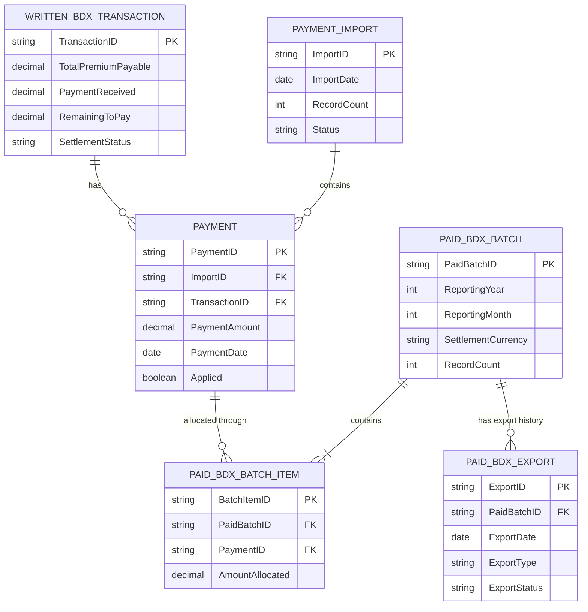

# BDX Runoff — Logical Entity Relationship Diagram

This simplified logical ERD illustrates the main entities and relationships supporting Written BDX settlement and Paid BDX export processing.

The diagram is a portfolio-level representation of the business relationships, not a physical database specification.

## Relationship Notes

- A Written BDX transaction can have multiple payments.
- An import can contain multiple payment records.
- Payments are linked to batches through allocation records.
- A batch can have multiple export events, including regeneration.
- The allocation entity preserves the history of which payments were included in each batch.

## Design Note

Entity and attribute names are illustrative portfolio names. The diagram simplifies the original business model and does not define every field, constraint, or physical implementation detail.
