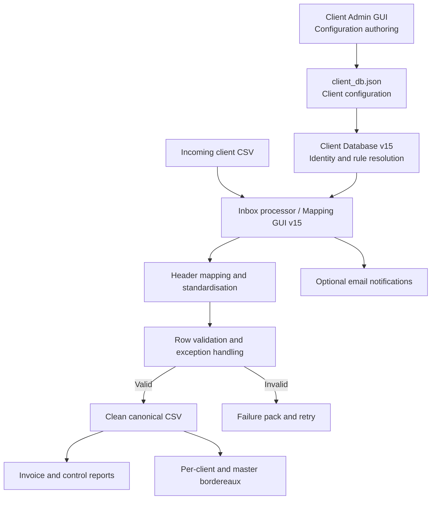

# Project 03 — GadgetClient: Configurable Data Mapping & Bordereau Processing

A Python-based proof of concept for processing client-supplied CSV files through a controlled mapping, validation and reporting pipeline.

The project is designed to convert inconsistent client data into a canonical structure, apply client-specific validation and value mappings, and produce repeatable operational outputs including invoice summaries and bordereaux.

> **Portfolio status:** Demonstration / proof of concept. The uploaded source set does not include every runtime component, so this repository should not be presented as a turnkey production deployment.

## Business problem

Client data arrives in different CSV layouts, with variations in column names, value formats and data quality. Manually remapping and checking each file creates repetitive effort and increases the risk of inconsistent outputs.

GadgetClient addresses this by separating client configuration from processing logic and applying a repeatable pipeline to incoming files.

## Solution overview

The documented architecture has three principal layers:

1. **Client Admin GUI — configuration authoring**  
   Defines client identity, aliases, field mappings, value maps, validation rules and notification recipients.
2. **Client Database v15 — runtime configuration and identity resolution**  
   Provides a controlled lookup layer over the client configuration JSON, including deterministic client resolution and audit metadata.
3. **Mapping GUI v15 — processing engine**  
   Detects CSV headers and delimiters, applies mappings, validates rows, standardises values and generates downstream outputs.

The Admin GUI and Client Database are described in the supplied technical documentation, but their Python source files were not included in this upload. The mapping engine imports `client_db_v15.py`, which must be supplied separately before the application can run end to end.

## Key capabilities

- CSV header and delimiter detection.
- Automatic header mapping suggestions using synonyms and similarity matching.
- Manual mapping and JSON mapping persistence.
- Client identity resolution using IDs, exact names, aliases and conservative fuzzy matching.
- Client-specific field and value mappings.
- Row-level validation for required identifiers, dates, premium values and cover attributes.
- Strict validation mode that blocks exports when configured value rules fail.
- Standardised clean CSV output.
- Invoice, micro-summary, backup, exception and control reports.
- Per-client and master bordereau outputs.
- Inbox processing in one-off or watch mode.
- Structured failure packs containing the source file and diagnostic artefacts.
- Optional success and failure email notifications.
- Month-based folder organisation and timestamped processing archives.

## Architecture



## Processing lifecycle

1. A client CSV is placed in `in/Inbox/` or `in/Inbox/YYYY-MM/`.
2. The processor determines the invoice month and detects headers, delimiter and encoding.
3. Client identity is resolved where a matching client configuration is available.
4. Client-specific mappings, saved mappings or auto-suggestions are applied according to the mapping priority.
5. Required fields and row-level values are validated.
6. Valid records are written to the canonical clean CSV structure.
7. Optional invoice, control and bordereau outputs are generated.
8. Successful source files are archived under `Processed`; failed files are placed into structured failure packs for investigation and controlled retry.
9. Optional notification emails report success or failure.

## Repository structure

```text
GadgetClient/
├── README.md
├── requirements.txt
├── .gitignore
├── config/
│   └── inbox_config.example.json
├── src/
│   └── mapping_gui_v15.py
├── docs/
│   ├── architecture-and-data-flow.pdf
│   ├── client-database-summary.pdf
│   ├── email-notifications.pdf
│   ├── folder-structure.pdf
│   └── technical-review.md
└── .github/
    └── workflows/
        └── python-syntax.yml
```

## Technology

- Python 3.10+
- PySimpleGUI for the desktop interface
- openpyxl for Excel workbook generation
- JSON for client configuration and saved mappings
- Python standard library for CSV processing, validation, file handling and SMTP notifications

## Setup notes

1. Create and activate a Python virtual environment.
2. Install dependencies from `requirements.txt`.
3. Supply the companion `client_db_v15.py` module and the Client Admin GUI source if you want to run the complete documented architecture.
4. Copy `config/inbox_config.example.json` to the local runtime configuration location and enter environment-specific SMTP details. Do not commit real credentials.
5. Review the hard-coded base directory in `src/mapping_gui_v15.py` before running on another machine.

The current source uses a Windows base directory (`C:\\GadgetClient`). Runtime testing also requires the missing companion module and an installed GUI dependency.

## Data protection and safe publication

Do not commit:

- Real client CSV files or customer/member information.
- Production client configuration or mapping JSON files.
- SMTP credentials, passwords, API keys or `.env` files.
- Generated invoices, bordereaux, reconciliation reports or failure packs containing live data.

Only synthetic or anonymised sample data should be used in demonstrations.

## Validation status

The supplied Python file was reviewed and corrected for syntax and several integration issues. It passes Python bytecode compilation. Full runtime and business-rule testing has **not** been completed because the companion `client_db_v15.py` module, Client Admin GUI source and representative synthetic test files were not supplied.

See [`docs/technical-review.md`](docs/technical-review.md) for the review findings and outstanding work.
