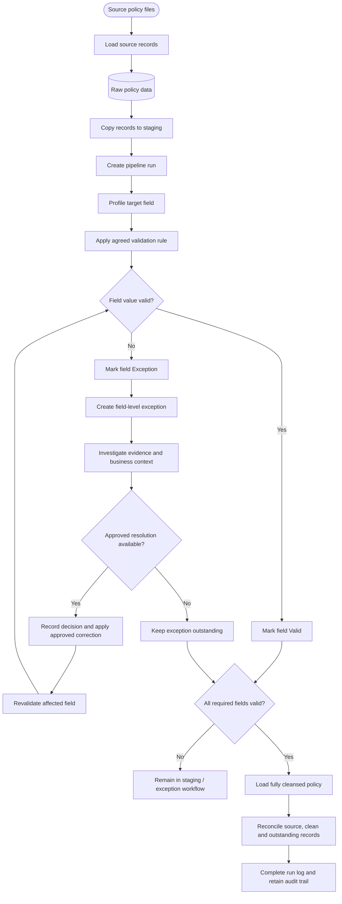

# Project 04 — Cleansing Process

## End-to-end process map

## Process controls

1. **Preserve:** raw source data is not overwritten.
2. **Profile:** inspect the field before deciding how to validate it.
3. **Define:** agree a technical rule and identify where business judgement is required.
4. **Validate:** assign a field-level status for every record in the run.
5. **Route:** create an exception for each failed field, retaining the original value and reason.
6. **Resolve:** investigate and record the evidence and approved decision; do not guess.
7. **Revalidate:** confirm the corrected or standardised value passes the same rule.
8. **Release:** load a policy to the final clean table only when all required fields pass.
9. **Reconcile:** account for source records and retain run-level evidence.

## Important reconciliation distinction

Field-level reconciliation and whole-policy reconciliation answer different questions.

For the first Written Premium use case, the field-level profile is:

`100 source records = 77 Written Premium format-valid + 23 Written Premium format exceptions`

This does not mean 77 complete policies are ready for the final clean table. Whole-policy reconciliation is performed only after all required fields have been processed and each policy can be classified as fully clean or still carrying one or more outstanding exceptions.
