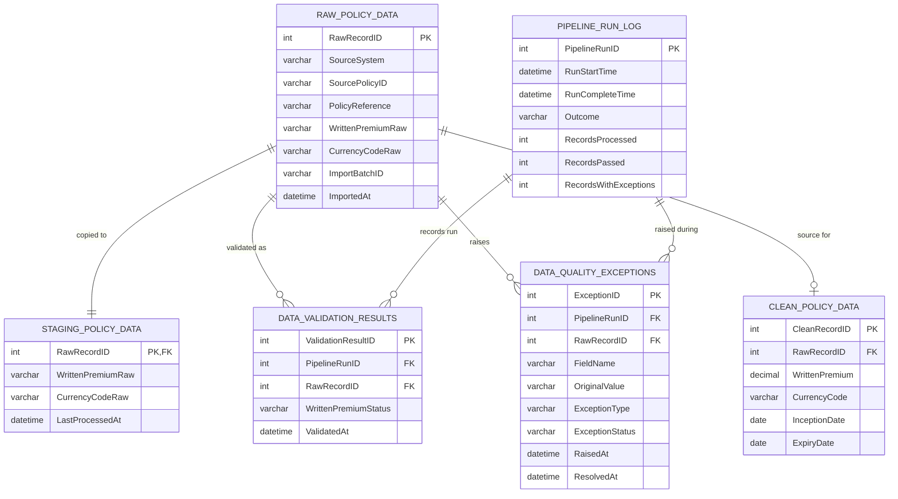

# Project 04 — Data Model

## Purpose

This document describes the current logical relationships in the MySQL cleansing pipeline. It distinguishes implemented database objects from planned extensions.

## Entity relationship diagram

The diagram is a relationship-level view. The physical tables contain additional policy attributes and validation-status columns.

## Grain and relationship rules

| Object | Grain | Purpose |
|---|---|---|
| `raw_policy_data` | One row per imported source record | Immutable source evidence |
| `Staging_Policy_Data` | One row per raw record | Working copy for processing |
| `pipeline_run_log` | One row per pipeline execution | Run-level audit and outcome |
| `data_validation_results` | One row per raw record per run | Wide snapshot of field validation statuses |
| `data_quality_exceptions` | One row per field-level exception per run | Investigation and resolution tracking |
| `clean_policy_data` | One row per fully cleansed policy | Final validated output |

## Key design decisions

- Raw source values are retained unchanged.
- Validation results are stored as a wide snapshot: one row per policy per pipeline run, with a separate status for each field.
- Validation status and exception management are separate concerns. A validation result records pass/fail; an exception records the issue requiring investigation.
- A policy may have multiple field-level exceptions, so exception counts must not be mistaken for distinct policy counts.
- The clean policy table is reserved for records that pass all required field and business-rule checks. Passing one field does not make the whole policy clean.
- Pipeline run records are at execution grain, not policy grain.

## Implementation status

Implemented: raw, staging, pipeline run log, validation results, exception register and final clean table.

Planned for a later stage: dedicated cleansing-rule and business-decision registers, plus any additional audit history required by the resolution workflow.
