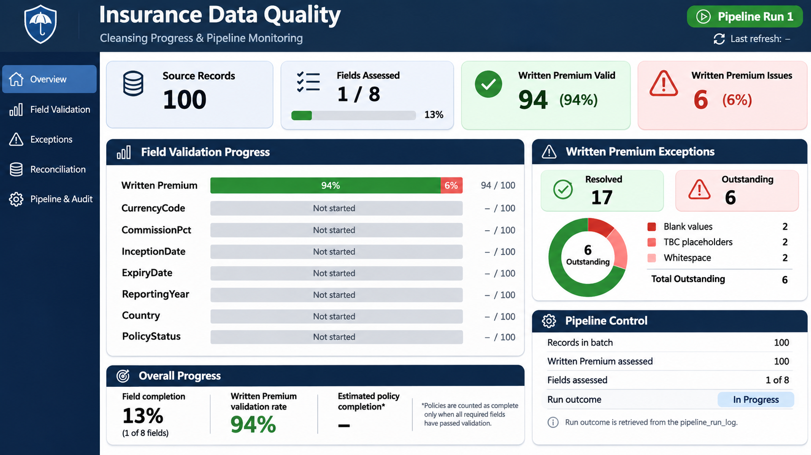

# Power BI Reporting

## Purpose

The Power BI reporting layer will provide a clear view of data quality across the Insurance Data Cleansing Pipeline. It is intended to help business users understand what has been processed, which fields have passed validation, where exceptions remain, and whether records are ready for release.

The dashboard will use purpose-built SQL reporting views as its source. This keeps the business-facing report separate from the underlying processing tables and gives each measure a consistent, testable definition.

## Dashboard concept

The proposed dashboard is designed around five reporting areas:

1. **Executive Overview** — headline pipeline progress, record counts, validation position and outstanding exceptions.
2. **Field Validation** — valid, exception and pending results by field, so progress can be tracked as cleansing moves through the policy attributes.
3. **Exception Management** — outstanding and resolved exceptions, exception reasons and record-level detail for investigation.
4. **Reconciliation** — movement between raw, staging and clean records, with clear explanations for any records not yet released.
5. **Pipeline & Audit** — pipeline run history, processing outcomes and audit information.

The mock-up below illustrates the proposed visual direction. It is a design concept, not a live Power BI report.

  

## Reporting principles

- **Show field-level and policy-level status separately.** A policy passing Written Premium validation does not mean the whole policy is clean.
- **Make exceptions visible.** Outstanding values must not disappear into totals or be silently replaced.
- **Do not assume business answers.** Missing or ambiguous values remain exceptions until an authorised decision is recorded.
- **Reconcile every headline measure.** Dashboard totals should match the SQL reporting views and the underlying pipeline results.
- **Retain context.** Users should be able to move from summary measures to field, exception and record-level detail.

## Initial reporting measures

The first dashboard iteration can report the Written Premium use case while the remaining fields are processed.

| Measure | Current position |
|---|---:|
| Source policy records | 100 |
| Written Premium — Valid | 94 |
| Written Premium — Outstanding exceptions | 6 |
| Original Written Premium exceptions resolved | 17 |

The six outstanding Written Premium values comprise two blanks, two `TBC` placeholders and two whitespace-only values. No replacement premium has been assumed. These figures are the manually verified field-level results for Written Premium; they are not live Power BI measures and do not represent whole-policy cleansing status.

## Proposed SQL reporting layer

The dashboard is expected to consume the following views, subject to confirmation of final columns and definitions:

| SQL view | Reporting purpose |
|---|---|
| `vw_pipeline_run_summary` | Pipeline executions, record counts and run outcomes |
| `vw_field_validation_summary` | Valid, Exception and Pending counts by field and run |
| `vw_exception_summary` | Exception status and reason summaries |
| `vw_exception_detail` | Record-level exception investigation |
| `vw_policy_quality_status` | Whole-policy status across required fields |
| `vw_reconciliation_summary` | Raw, staging, validated and clean record reconciliation |

Care is required when joining field-level validation results and exceptions: multiple exceptions can exist for one policy. Summary measures must use the correct grain to avoid double-counting.

## Delivery approach

The report will be developed incrementally:

1. Create and test the SQL reporting views.
2. Connect Power BI to the MySQL reporting layer.
3. Build the Executive Overview and Field Validation pages using the Written Premium results.
4. Add exception and reconciliation detail.
5. Extend the report as CurrencyCode and subsequent fields are profiled, cleansed and validated.
6. Add pipeline run and audit reporting.
7. Reconcile every Power BI measure to SQL before treating the dashboard as an accepted project deliverable.

## Current status

**Design stage — dashboard concept prepared.** The MySQL cleansing pipeline is progressing field by field. Power BI is not yet connected to the database, and the mock-up is illustrative rather than an operational report.

See the [project README](../README.md), [development plan](./development_plan.md) and [Written Premium use case](./use_case_01_written_premium.md) for the wider project context and current validation evidence.
